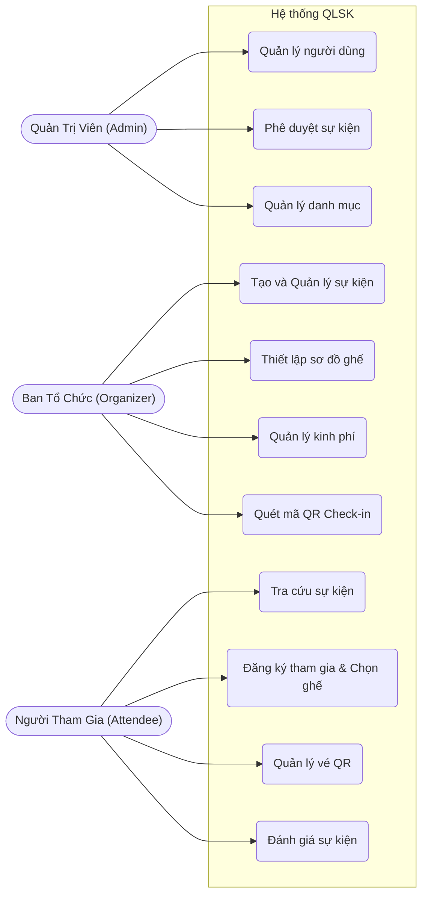
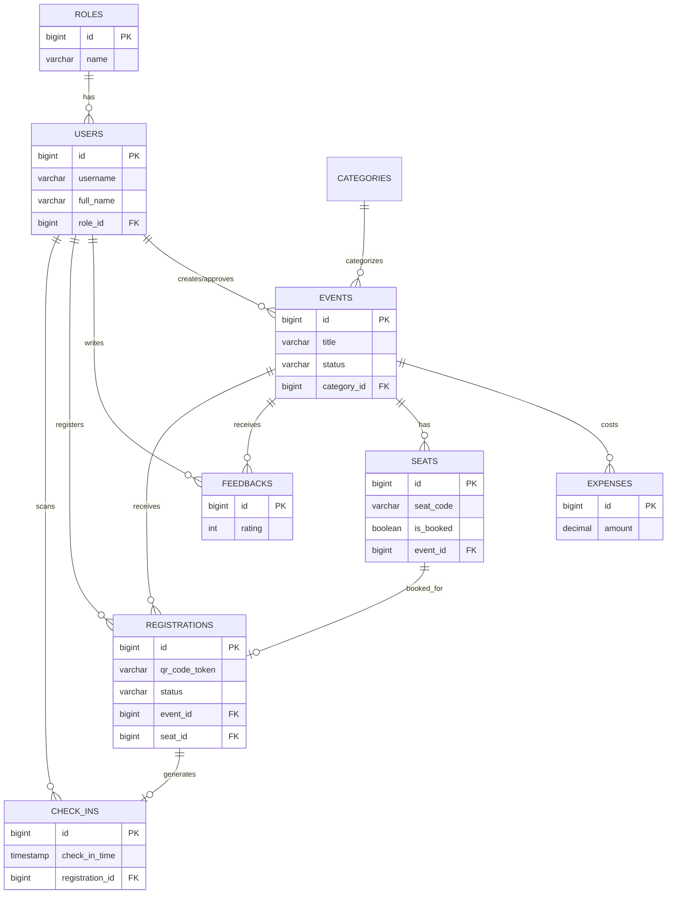
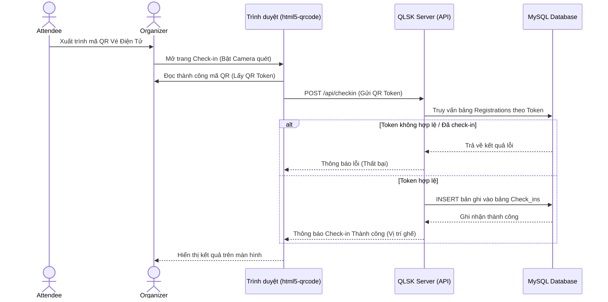

# BÁO CÁO BÀI TẬP LỚN: HỆ THỐNG QUẢN LÝ TỔ CHỨC SỰ KIỆN VÀ KIỂM SOÁT THAM DỰ (QLSK)

---

## CHƯƠNG 1: TỔNG QUAN DỰ ÁN

### 1.1. Đặt vấn đề
Trong thời đại số hóa, việc tổ chức và quản lý sự kiện (hội thảo, khóa học, giải đấu thể thao, nghệ thuật...) đòi hỏi tính chuyên nghiệp, nhanh chóng và chính xác. Các phương pháp quản lý thủ công (ghi danh qua giấy tờ, điểm danh thủ công, bán vé vật lý) không còn đáp ứng được nhu cầu do dễ gây sai sót, tốn kém chi phí in ấn và mất thời gian cho việc check-in. 
Từ đó, bài toán đặt ra là cần một hệ thống quản lý sự kiện toàn diện, khép kín từ khâu lên kế hoạch, duyệt sự kiện, mở đăng ký, chọn chỗ ngồi cho đến quản lý vé điện tử, check-in thời gian thực và quản lý ngân sách.

### 1.2. Mục tiêu dự án
Dự án **QLSK** được xây dựng nhằm cung cấp một nền tảng Web Application giải quyết triệt để các vấn đề trên. Mục tiêu chính bao gồm:
- Số hóa quy trình tạo và phê duyệt sự kiện.
- Cung cấp trải nghiệm đăng ký và chọn sơ đồ chỗ ngồi trực quan.
- Tự động hóa phát hành vé điện tử (QR Code).
- Kiểm soát ra vào (Check-in) nhanh chóng bằng camera quét QR.
- Quản lý tài chính, thu chi sự kiện minh bạch.
- Đánh giá chất lượng sự kiện sau khi hoàn thành.

### 1.3. Đối tượng sử dụng hệ thống
Hệ thống được thiết kế đa người dùng, phục vụ 3 nhóm đối tượng chính:
1. **Quản Trị Viên (Admin):** Người kiểm soát toàn hệ thống, phê duyệt sự kiện và quản lý tài khoản.
2. **Ban Tổ Chức (Organizer):** Người trực tiếp tạo, vận hành và quản lý thu chi, check-in sự kiện.
3. **Người Tham Gia (Attendee):** Khách hàng/người dùng cuối thực hiện đăng ký, nhận vé và tham gia đánh giá sự kiện.

---

## CHƯƠNG 2: CÔNG NGHỆ VÀ CÔNG CỤ SỬ DỤNG

### 2.1. Backend (Xử lý logic và API)
- **Ngôn ngữ lập trình:** Java 17+
- **Framework:** Spring Boot 3.2.5 (Spring MVC, Spring Data JPA, Spring Security, Spring Validation).
- **Bảo mật:** JSON Web Token (JWT) cho Stateless Authentication.
- **Thư viện xử lý mã vạch:** Google ZXing Library (Tạo mã vé QR Code định dạng PNG/Base64).
- **Công cụ quản lý thư viện (Build tool):** Maven (`pom.xml`).

### 2.2. Frontend (Giao diện người dùng)
- **Công nghệ nền tảng:** HTML5, CSS3, Vanilla JavaScript.
- **Thư viện hỗ trợ:** `html5-qrcode` (Hỗ trợ quét mã QR bằng camera trực tiếp trên trình duyệt web).
- **Thiết kế (UI/UX):** Responsive, tối ưu hóa hiển thị trên nhiều thiết bị, chia layout độc lập cho từng role.

### 2.3. Cơ sở dữ liệu
- **Hệ quản trị CSDL:** MySQL 8.0+

---

## CHƯƠNG 3: PHÂN TÍCH YÊU CẦU VÀ CHỨC NĂNG HỆ THỐNG

### 3.1. Phân hệ Quản Trị Viên (ROLE_ADMIN)
- **Quản lý người dùng:** Xem danh sách, phân quyền hoặc khóa tài khoản của Ban tổ chức và Người tham gia.
- **Phê duyệt sự kiện:** Các sự kiện do Organizer tạo ra sẽ ở trạng thái DRAFT (Nháp), Admin có quyền xem xét và chuyển sang trạng thái APPROVED (Đã duyệt) để sự kiện được phép công khai.
- **Quản lý danh mục (Categories):** Thêm, sửa, xóa các danh mục sự kiện (VD: Công nghệ, Nghệ thuật, Thể thao...).
- **Báo cáo tổng quan:** Theo dõi số lượng sự kiện, tài khoản và các luồng hoạt động thống kê của toàn hệ thống.

### 3.2. Phân hệ Ban Tổ Chức (ROLE_ORGANIZER)
- **Quản lý sự kiện:** Tạo mới, chỉnh sửa thông tin sự kiện (thời gian, địa điểm, mô tả, sức chứa).
- **Sơ đồ chỗ ngồi (Seat Map):** Thiết lập sơ đồ chỗ ngồi (số hàng, số cột) để cho phép khách hàng tự chọn ghế.
- **Quản lý kinh phí (Expenses):** Lập bảng dự toán và ghi nhận các khoản thu chi của sự kiện.
- **Trạm Check-in (QR Check-in):** Sử dụng camera thiết bị (điện thoại, máy tính bảng, webcam laptop) để quét mã QR trên vé của khách hàng, cập nhật trạng thái tham dự theo thời gian thực (Real-time).
- **Thống kê & Báo cáo sự kiện:** Xem danh sách khách đăng ký, đánh giá sao, và báo cáo tài chính của sự kiện mình tổ chức.

### 3.3. Phân hệ Người Tham Gia (ROLE_ATTENDEE)
- **Tra cứu sự kiện:** Khám phá, lọc và tìm kiếm sự kiện theo danh mục hoặc thời gian.
- **Đăng ký tham gia:** Đăng ký tham gia sự kiện và chọn ghế ngồi trực quan trên sơ đồ ghế.
- **Vé của tôi (My Tickets):** Quản lý danh sách các sự kiện đã đăng ký, xem mã QR điện tử để trình diện khi check-in, hoặc hủy vé nếu không thể tham dự.
- **Đánh giá (Feedback):** Gửi đánh giá (Rating 1-5 sao) và bình luận sau khi sự kiện kết thúc.

### 3.4. Biểu đồ Use Case tổng quát


---

## CHƯƠNG 4: THIẾT KẾ CƠ SỞ DỮ LIỆU

Cơ sở dữ liệu **qlsk_db** được chuẩn hóa với các bảng (Tables) có mối liên hệ mật thiết (Foreign Keys). Cấu trúc chính bao gồm 9 bảng:

1. **`roles` & `users`:** Quản lý thông tin tài khoản, mật khẩu (được mã hóa BCrypt), và phân quyền hệ thống.
2. **`categories`:** Lưu trữ phân loại sự kiện.
3. **`events`:** Bảng trung tâm lưu thông tin sự kiện. Quản lý linh hoạt qua trường `status` (DRAFT, APPROVED, OPEN_FOR_REGISTRATION, FULL, ONGOING, COMPLETED, CANCELLED). Bảng này liên kết với `categories`, `users` (người tạo) và `users` (người duyệt).
4. **`seats`:** Quản lý chi tiết từng vị trí ghế ngồi (hàng, cột, loại ghế, trạng thái đã đặt), liên kết 1-N với bảng `events`.
5. **`registrations`:** Lưu trữ lịch sử đăng ký vé. Ghi nhận `qr_code_token` duy nhất, vị trí ghế (`seat_id`) và người đăng ký (`user_id`).
6. **`check_ins`:** Quản lý dữ liệu điểm danh. Ghi nhận thời gian check-in chính xác và nhân viên (Organizer) đã thực hiện quét mã.
7. **`expenses`:** Lưu các khoản chi tiêu (tiêu đề, số tiền, ngày chi) liên kết với từng sự kiện.
8. **`feedbacks`:** Lưu trữ điểm đánh giá và nhận xét của User cho Event.

### 4.1. Lược đồ Thực thể Liên kết (ERD)


---

## CHƯƠNG 5: KIẾN TRÚC PHẦN MỀM & CẤU TRÚC MÃ NGUỒN

Hệ thống được thiết kế theo kiến trúc **N-Tier Architecture (Kiến trúc phân tầng)** kết hợp mô hình **MVC** của Spring Boot.

### 5.1. Các Tầng (Layers) trong Backend
- **Tầng Controllers (`com.qlsk.controller`):** Định nghĩa các REST API Endpoints, tiếp nhận HTTP Request từ Client, gọi Service xử lý và trả về JSON Response. 
- **Tầng Services (`com.qlsk.service`):** Nơi chứa Business Logic (nghiệp vụ cốt lõi). Ví dụ: Kiểm tra logic hết vé, tính toán ngân sách, sinh mã QR,...
- **Tầng Repositories (`com.qlsk.repository`):** Giao tiếp với MySQL thông qua Spring Data JPA/Hibernate.
- **Tầng DTO (`com.qlsk.dto`):** Đối tượng truyền dữ liệu, đảm bảo ẩn đi các thông tin nhạy cảm của Entity trước khi trả về cho Client.
- **Tầng Security (`com.qlsk.security`):** Chứa các bộ lọc (Filter) xử lý giải mã JWT, xác thực tính hợp lệ của Token và chặn các request không đủ thẩm quyền.

### 5.2. Cấu trúc thư mục (Project Structure)
```
src/main/
├── java/com/qlsk/
│   ├── config/          # Cấu hình CORS, Spring Security
│   ├── controller/      # REST APIs (Auth, Event, Registration, CheckIn,...)
│   ├── dto/             # Request/Response Data Transfer Objects
│   ├── entity/          # JPA Entities mapping với MySQL
│   ├── exception/       # Xử lý lỗi tập trung (GlobalExceptionHandler)
│   ├── repository/      # Spring Data JPA Repositories
│   ├── security/        # JWT Filter, Token Provider
│   └── service/         # Business Logic xử lý nghiệp vụ
└── resources/
    ├── application.properties  # File cấu hình DB
    └── static/                 # Frontend
        ├── css/, js/           # Tài nguyên tĩnh
        ├── admin/              # Giao diện cho Admin
        ├── organizer/          # Giao diện cho Ban Tổ Chức
        └── *.html              # Giao diện cho Khách / Người tham gia
```

---

## CHƯƠNG 6: CÁC TÍNH NĂNG VÀ CÔNG NGHỆ NỔI BẬT

### 6.1. Bảo Mật Không Trạng Thái (Stateless Authentication với JWT)
Thay vì sử dụng Session truyền thống, hệ thống cấp phát JSON Web Token (JWT) khi người dùng đăng nhập thành công. Token này chứa thông tin User ID và Role. Frontend lưu trữ Token và đính kèm vào Header (`Authorization: Bearer <token>`) của mọi HTTP request gửi lên server (file `api.js`). Hệ thống backend tự động giải mã và cấp quyền tương ứng, giúp giảm tải cho server, dễ dàng mở rộng và ngăn chặn lỗi CSRF.

### 6.2. Vé Điện Tử & Quét QR Code Thời Gian Thực
- Mỗi lượt đăng ký thành công, server (Service `QrCodeService`) sử dụng thư viện **Google ZXing** để tạo một chuỗi token mã hóa duy nhất và vẽ thành một hình ảnh QR Code (Base64) trả về cho người dùng.
- Tại cổng sự kiện, Ban tổ chức sử dụng trang Check-in (`checkin.html`). Trang này được tích hợp thư viện **`html5-qrcode`**, xin cấp quyền truy cập Camera của trình duyệt. Sau khi camera đọc được QR Code từ điện thoại của khách, mã này được tự động gửi qua API (`/api/checkin`) lên server. Server xác minh tính hợp lệ và ghi nhận check-in thành công chỉ trong vài mili-giây.

**Biểu đồ Tuần tự (Sequence Diagram) - Luồng Quét mã QR Check-in:**


### 6.3. Sơ Đồ Ghế Ngồi Tương Tác
Tính năng nổi bật cho các sự kiện có quy mô là việc chọn ghế ngồi. Tại giao diện Đăng ký (`event-detail.html`), sơ đồ ghế được render động bằng JavaScript kết hợp CSS Grid dựa trên số Hàng x Cột do BTC cấu hình.
Trạng thái các ghế được đồng bộ:
- Ghế trống (Có thể click chọn)
- Ghế đã được đặt (Vô hiệu hóa - Disabled)
Giúp khách hàng trực quan hóa vị trí mong muốn và hệ thống kiểm soát tránh tình trạng overbooking (bán lố vé).

---

## CHƯƠNG 7: KẾT LUẬN

### 7.1. Kết quả đạt được
Dự án "Hệ Thống Quản Lý Tổ Chức Sự Kiện VÀ Kiểm Soát Tham Dự (QLSK)" đã hoàn thành tốt các mục tiêu đề ra, bao gồm:
- Xây dựng thành công ứng dụng Web tương tác với giao diện thân thiện.
- Tích hợp trơn tru quy trình quản lý sự kiện từ số hóa vé, thanh toán đến kiểm soát QR code.
- Áp dụng các chuẩn công nghệ hiện đại (Spring Boot 3, RESTful API, JWT) đảm bảo hệ thống có độ an toàn và khả năng mở rộng cao.

### 7.2. Hướng phát triển tương lai
- Tích hợp cổng thanh toán trực tuyến (VNPay, Momo) cho các sự kiện có thu phí.
- Thêm tính năng chat/hỗ trợ trực tuyến giữa BTC và người tham gia.
- Tối ưu hóa UI/UX trên phiên bản Mobile App (Android/iOS) bằng React Native hoặc Flutter cho trải nghiệm quét QR và quản lý vé tiện lợi hơn.
- Cải thiện thuật toán đề xuất sự kiện cho người dùng dựa trên sở thích (Recommendation System).

--- 
*Hết báo cáo.*
